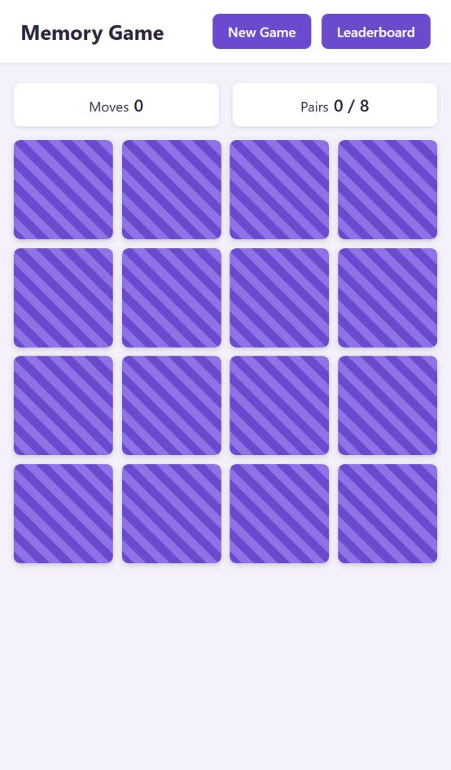
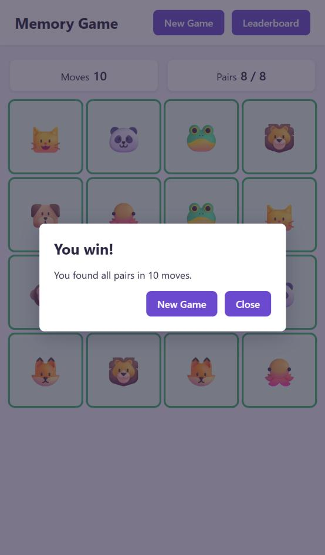

# Memory Game

A card-matching game in plain HTML, CSS and JavaScript. Flip two cards at a time, find all 8 pairs in as few moves as possible and get on the leaderboard.

Task: [RS School — Memory Game](https://github.com/rolling-scopes-school/tasks/tree/master/tasks/memory-game)

Deploy: <https://vasilyeuuv.github.io/memory-game/>

## How to play

1. The game starts automatically: all 16 cards lie face down.
2. Click a card to open it, then click a second one. That is one move.
3. If the cards match, they stay open. If not, they close again after a moment.
4. Find all 8 pairs. The fewer moves you make, the higher you rank.
5. **New Game** reshuffles and deals the cards again at any time; **Leaderboard** shows the 10 best results.

